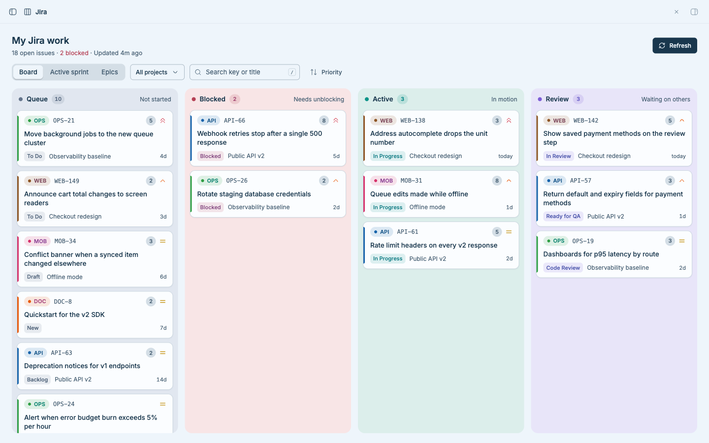
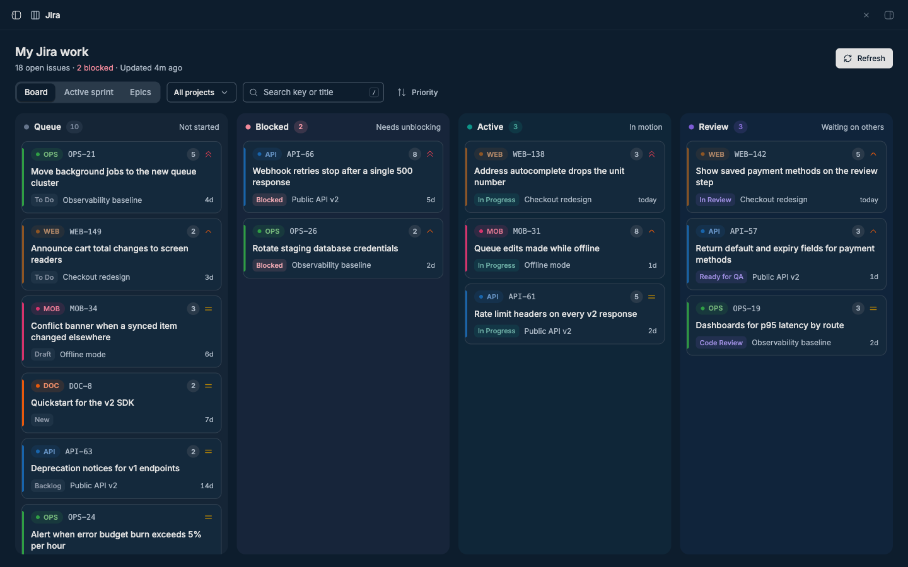
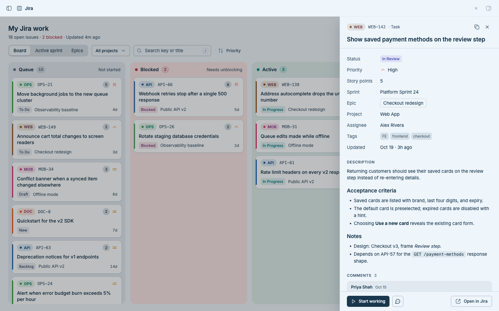
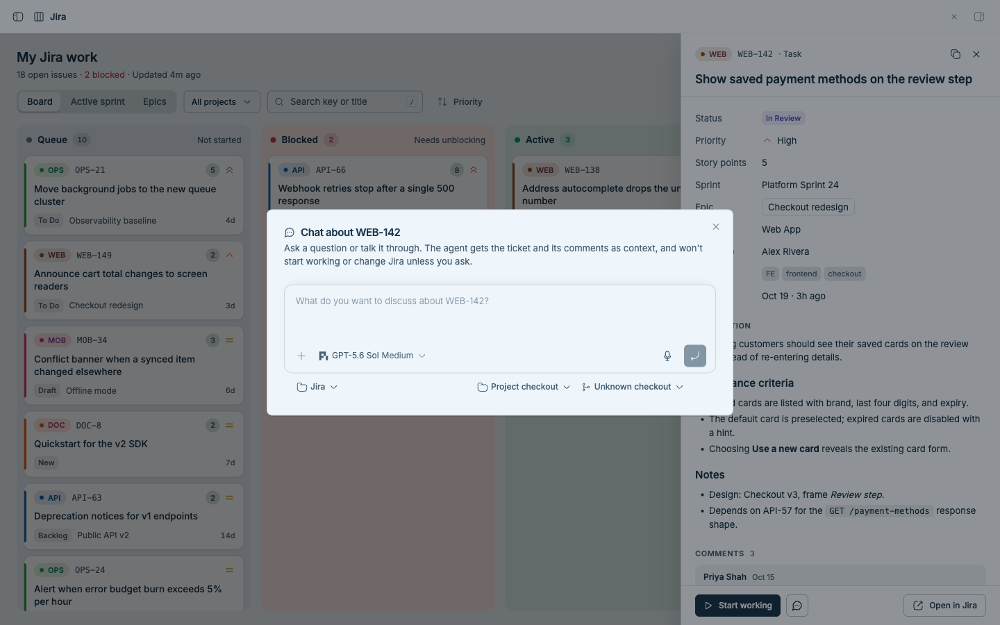
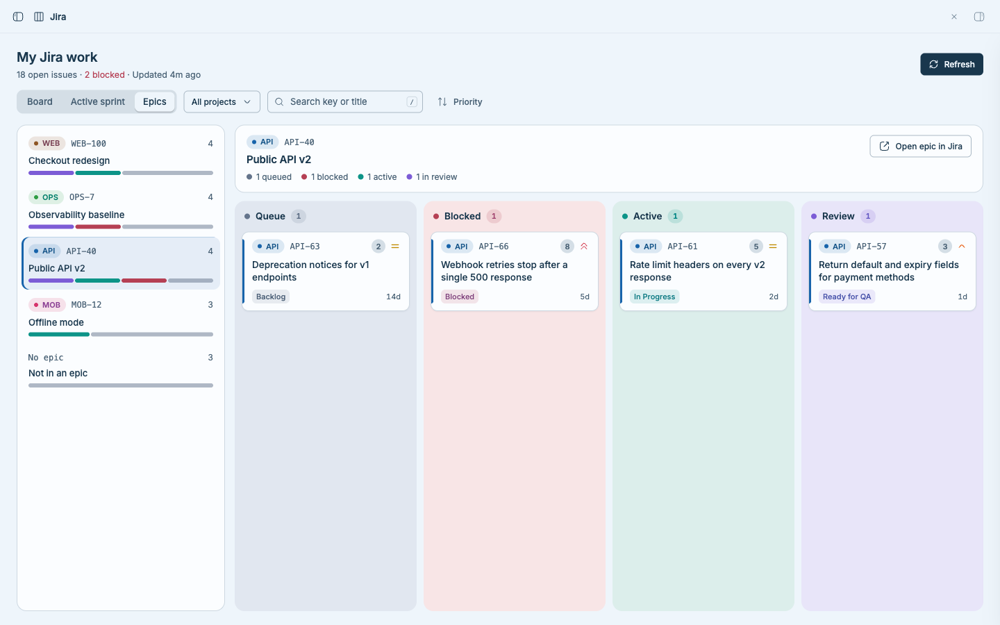
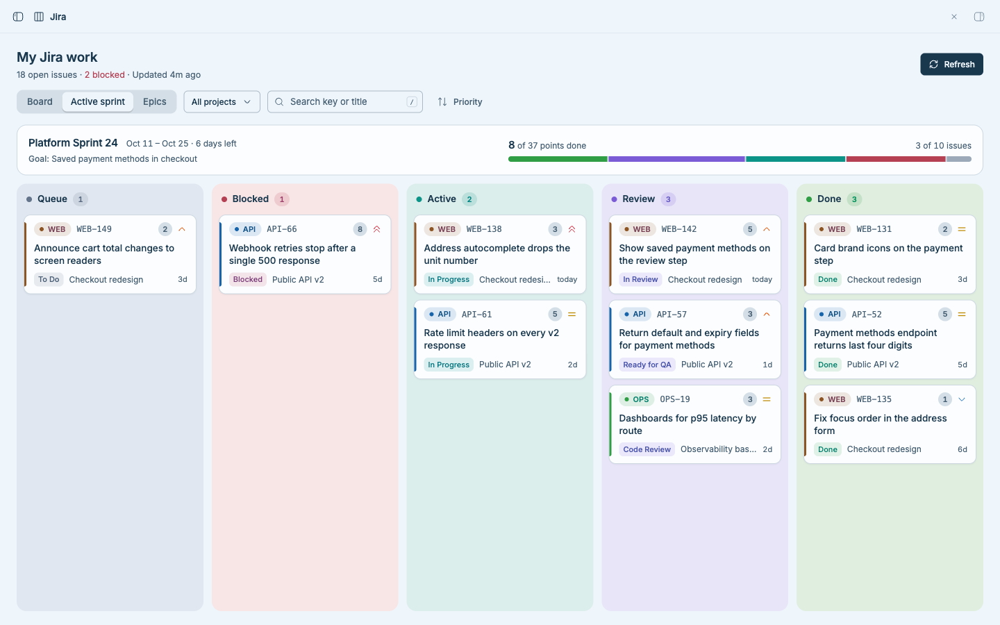
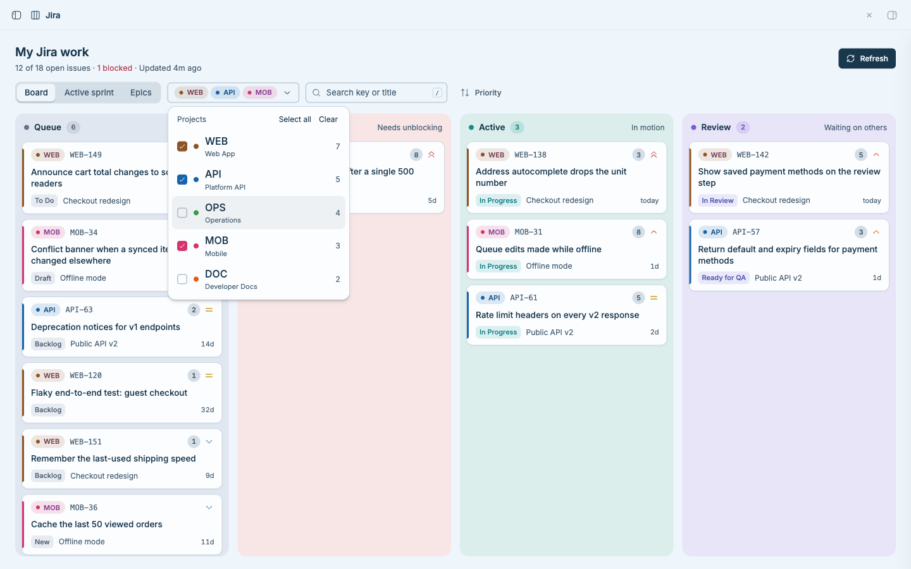
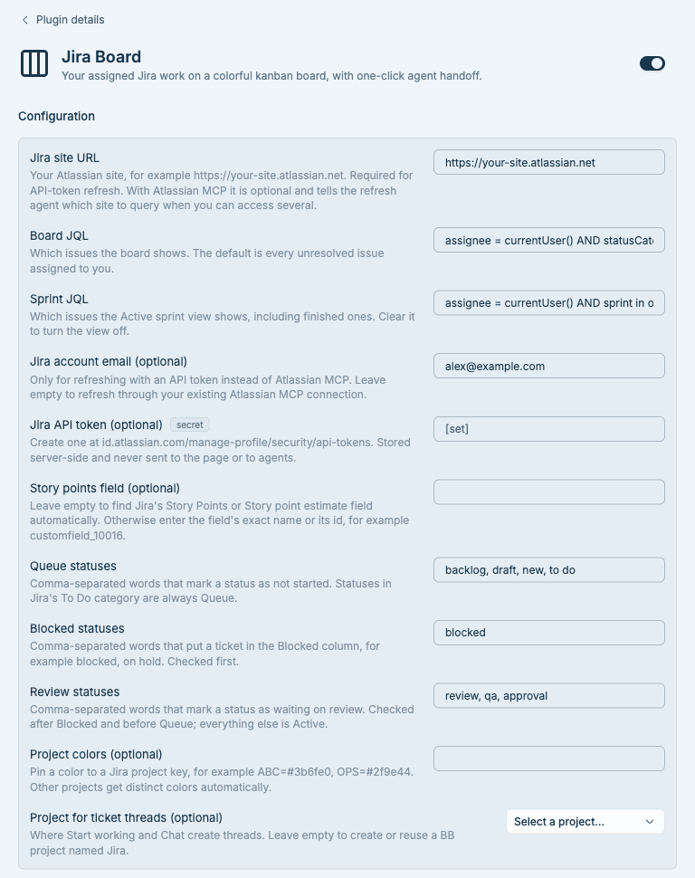

# Jira Board for BB

Jira Board adds a **Jira** page to BB's sidebar that shows the open Jira issues
assigned to you, across every project and epic, on one colorful kanban board.
From any ticket you can hand the work to an agent or start a conversation about
it, without leaving BB. Jira itself stays read-only.



## What you get

- **Board view.** Your exact Jira statuses are grouped into four equal
  columns: **Queue** (not started), **Blocked** (needs unblocking), **Active**
  (in motion), and **Review** (waiting on others). Each card shows a colored
  project tag, the exact status, story points, priority, epic, and how long
  since it changed.
- **Active sprint view.** Your tickets in the sprint that's running now,
  including finished ones in a **Done** column, with the sprint's dates, days
  left, goal, and a points-based progress bar. If you're in more than one
  active sprint, switch between them at the top.
- **Epics view.** Every epic with a small progress bar. Pick one to see its
  tickets in the same four columns.
- **Project filter.** A compact multi-select picker, remembered between visits.
  Search, priority/recent/stale sorting, and keyboard shortcuts (`/` to search,
  `J`/`K` to move between tickets, Esc to close details).
- **Ticket details.** A slide-in panel with story points, the rendered
  description, tags, parent epic, and the full comment timeline.
- **Start working.** Hands the ticket to an agent in BB. The thread opens with a
  short "Start working on KEY" message; the agent privately receives the ticket,
  its comments, and instructions to plan and begin the work.
- **Chat about this ticket.** The chat icon opens BB's composer. Nothing is sent
  until you write your own first message; the agent gets the ticket as hidden
  context and is told not to start working or change Jira unless you ask.
- **Manual refresh** through the Atlassian MCP connection BB already has, or an
  optional Jira API token. A failed refresh never clears the last good board.

## Prerequisites

- BB 0.45 or newer with Plugin SDK 0.6.15 compatibility.
- One of:
  - **Atlassian MCP** (recommended): Atlassian's MCP server connected and
    signed in for BB agents. No API token is needed.
  - **A Jira Cloud API token** for your Atlassian account.
- An agent provider in BB for MCP refresh, Start working, and Chat.

Installing a third-party plugin runs its code with full trust.

## Installation

Install the latest compatible 0.1 release from GitHub:

```sh
bb plugin install 'git:https://github.com/jgarrow-springhealth/bb-plugin-jira-board.git@^0.1.0'
```

For local development or evaluation from this checkout:

```sh
npm ci
bb plugin build
bb plugin install .
```

Open **Jira** from BB's sidebar and choose **Refresh**.

## Refreshing

Refresh is always manual.

**With Atlassian MCP** (no API token configured), the plugin starts a hidden,
short-lived BB agent that queries every result page and every comment page for
your JQL, then updates the board through the plugin's `jira_board_import` tool.
The board stays where it is, shows progress on the button, and updates in place;
the worker is archived and stopped afterwards. It never starts OAuth, opens an
authorization URL, or opens a browser. If Atlassian MCP is not already signed
in, refresh fails in place and the previous board stays visible.

**With an API token**, set the site URL, account email, and token in settings.
Refresh then calls Jira's REST API directly, without an agent, and fetches all
comments with bounded concurrency. The token stays server-side and never reaches
the page or any agent.

## Configuration

Open **Settings → Plugins → Jira Board**:

| Setting | Default | Effect |
| --- | --- | --- |
| Jira site URL | empty | Your site, for example `https://your-site.atlassian.net`. Required for API-token refresh. With MCP it is optional and tells the agent which site to use when you can access several. |
| Board JQL | `assignee = currentUser() AND statusCategory != Done ORDER BY updated DESC` | Which issues the board shows. |
| Sprint JQL | `assignee = currentUser() AND sprint in openSprints() ORDER BY updated DESC` | Which issues the Active sprint view shows, including finished ones. Clear it to turn the view off. Sites without Jira Software have no sprints. |
| Jira account email | empty | Only for API-token refresh. |
| Jira API token | empty (secret) | Only for API-token refresh. Create one at [id.atlassian.com](https://id.atlassian.com/manage-profile/security/api-tokens). |
| Story points field | empty | Leave empty to find Jira's "Story Points" or "Story point estimate" field automatically, or enter a field name or id such as `customfield_10016`. |
| Queue statuses | `backlog, draft, new, to do` | Words that mark a status as not started. Statuses in Jira's To Do category are always Queue. |
| Blocked statuses | `blocked` | Words that put a ticket in the Blocked column, for example `blocked, on hold`. Checked first. |
| Review statuses | `review, qa, approval` | Words that mark a status as waiting on review. Checked after Blocked; anything matching neither these nor Queue is Active. |
| Project colors | empty | Optional `KEY=#hex` pairs, for example `ABC=#3b6fe0, OPS=#2f9e44`. Other projects get distinct colors automatically. |
| Project for ticket threads | empty | The BB project that Start working and Chat use. Empty creates (on first use) or reuses a project named **Jira**. |

Status words match case-insensitively anywhere in the status name, so `review`
matches "In Review" and "Ready for Code Review". Settings changes update an
open board immediately. To restore a default:

```sh
bb plugin config jira-board unset <setting-key>
```

Setting keys are `jiraSiteUrl`, `jql`, `sprintJql`, `jiraEmail`, `jiraApiToken`,
`storyPointsField`, `queueStatuses`, `blockedStatuses`, `reviewStatuses`, `projectColors`, and `threadProject`.

## Commands

```sh
bb jira-board status [--json]   # refresh mode, cached issue count, last refresh
bb jira-board refresh [--json]  # API token when configured, otherwise Atlassian MCP
bb jira-board export            # cached snapshot, including comments, as JSON
bb jira-board import <file.json> [--json]
```

`export` and `import` round-trip the cache, which is useful for backups and
demos. A file may be an array of normalized issues or an object with `issues`
and optional `sprintIssues`, `sprints`, `refreshedAt`, and `source`. Agents refreshing through MCP use the
`jira_board_import` tool instead of a file.

## Permissions and data

- **Jira:** read-only. The plugin never transitions, edits, comments on, or
  drags issues. Agents it starts are told not to update Jira unless you ask.
- **Network:** API-token refresh calls your Jira site's REST API. MCP refresh
  goes through your own Atlassian MCP connection. Behind a TLS-inspecting
  proxy (Zscaler and similar), Jira requests fall back to your operating
  system's trusted certificates, for this plugin's requests only.
- **Storage:** the issue snapshot and per-issue comments in plugin storage;
  your project filter in the browser's local storage.
- **BB:** creates hidden refresh workers, and visible threads only when you
  choose Start working or send a chat. On first use without a configured
  project, it creates a **Jira** project backed by a small folder in BB's data
  directory.

## Development

```sh
npm ci
npm test
npm run typecheck
bb plugin build
```

Run `bb plugin types --check` to compare SDK declarations with the installed
BB. `npm run demo-snapshot` prints the fictional data used for the screenshots:

```sh
bb jira-board export > /tmp/jira-board-backup.json
npm run --silent demo-snapshot > /tmp/jira-board-demo.json
bb jira-board import /tmp/jira-board-demo.json
# ...look around or capture screenshots...
bb jira-board import /tmp/jira-board-backup.json
```

Source map:

- `server.ts` defines settings, refresh (REST and MCP worker), the cache, RPC,
  thread handoff, the agent tool, and the CLI.
- `app.tsx` renders the board, Epics view, filters, details drawer, and chat
  dialog.
- `board-model.ts` holds phase rules and project color assignment.
- `skills/jira-board/SKILL.md` tells BB agents how to refresh through MCP.

## Screenshots

All screenshots use the fictional data from `scripts/demo-snapshot.mjs`.

The board in BB's dark theme:



Ticket details with the description, comments, **Start working**, and the chat
icon:



Chatting about a ticket starts from your own message in BB's composer:



The Epics view, with one epic's tickets in the same four columns:



The Active sprint view, with the sprint's progress and a Done column:



The multi-select project filter:



Plugin settings, cropped to the plugin's detail page:



## License

MIT © 2026 Janessa Garrow. See [LICENSE](LICENSE).
